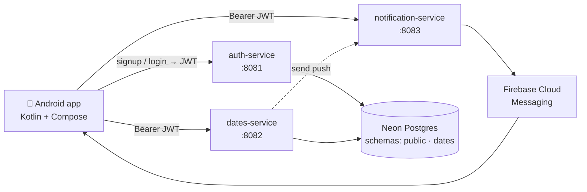

# Étoile ✨

A private date-planning app for two people. One person proposes a date, the other accepts, and the app helps settle the details (which movie, when, where) without endless back-and-forth.

Built as a hands-on learning project: **Kotlin + Jetpack Compose** on Android and **Java 21 + Spring Boot microservices** on the backend, all hosted for **$0**.

---

## Features

### Date types

| Type | Chosen at creation | Extra details |
|---|---|---|
| 🎬 **Movie date** (long-distance) | Date & time | 0–2 movie suggestions from each person |
| ☕ **Meeting** | Date & time, place | Google Maps link, activity |
| 🧳 **Trip** | Date range, place | Itinerary |

### How a date works

- **Propose → accept / reject / cancel.** The receiver gets a notification and can accept or reject (rejecting is free). Cancelling costs saying *sorry* five times: the proposer can withdraw a pending invitation, and once a date is accepted either person can cancel it.
- **Movie suggestions.** Title and release year are required. Synopsis, YouTube trailer (shown as a thumbnail) and up to 5 genres (shown as coloured capsules) are optional. Suggestions close 5 hours before the date.
- **Picking the movie.**
  - 0 suggestions → decided outside the app
  - 1 suggestion → that's the movie
  - 2+ suggestions → vote → if the vote splits, talk it out on a call → if still stuck, a weighted random pick
- **Rescheduling.** A reschedule is a *request*, not a new time. The other person gets reminders (paused at night) until they open it and acknowledge with a cheeky button. You agree on a time together, then either of you enters it. Only the requester can cancel a reschedule.
- **"Want some love?" 💗** Tap a heart and the other person gets a push notification.

### Genres

General: `ACTION` `ADVENTURE` `ANIMATION` `COMEDY` `CRIME` `DOCUMENTARY` `DRAMA` `FAMILY` `FANTASY` `HORROR` `MUSICAL` `MYSTERY` `ROMANCE` `SCI_FI` `THRILLER` `OTHER`

Anime: `ANIME` `SHONEN` `SHOJO` `SEINEN` `JOSEI` `ISEKAI` `MECHA` `SLICE_OF_LIFE` `MAGICAL_GIRL`

---

## Architecture



- **No API gateway (v1).** The app calls each service directly.
- **One database, separate schemas.** Each service owns its own tables.
- **Stateless JWT auth.** auth-service signs tokens (HS256). The other services only verify them, reading the user's id and role straight from the token.
- **Exactly two accounts.** Each user has a role, `HIM` or `HER`, and the database allows only one of each. The role drives small per-person differences in the app and the 60/40 tie-break weighting.

---

## Tech stack

| Layer | Tech |
|---|---|
| Backend | Java 21, Spring Boot 4.1, Spring Security (OAuth2 Resource Server / Nimbus JWT), Spring Data JPA, Bean Validation |
| Database | PostgreSQL on [Neon](https://neon.tech) (free tier) |
| Android | Kotlin, Jetpack Compose *(planned)* |
| Push | Firebase Cloud Messaging *(planned)* |
| Hosting | [Render](https://render.com) free tier *(planned)* |
| Build | Maven |

---

## Repository layout

```
etoile/
├── auth-service/          # signup, login, JWT issuing
├── dates-service/         # dates, suggestions, voting, rescheduling
├── notification-service/  # push notifications (planned)
└── android-app/           # Kotlin + Compose client (planned)
```

---

## Status

| Part | Status |
|---|---|
| auth-service | ✅ Done: signup, login, BCrypt, JWT, HIM/HER roles |
| dates-service | 🚧 In progress: create, accept/reject/cancel and suggestions done; rescheduling, movie decision and listing next |
| notification-service | ⏳ Not started |
| android-app | ⏳ Not started |
| Deployment (Render) | ⏳ Not started |

---

## Running locally

### Prerequisites

- JDK 21
- Maven (IntelliJ's bundled Maven works)
- A PostgreSQL database (a free [Neon](https://neon.tech) project works)

### Environment variables

Secrets are **never** stored in this repo. Each service reads them from environment variables. In IntelliJ, set them in the service's Run Configuration and keep *Store as project file* unticked.

| Variable | Used by | Description |
|---|---|---|
| `DB_URL` | all services | JDBC URL, e.g. `jdbc:postgresql://<host>/<db>?sslmode=require` |
| `DB_USER` | all services | Database user |
| `DB_PASSWORD` | all services | Database password |
| `JWT_SECRET` | all services | Base64-encoded key of at least 32 random bytes. **Must be identical in every service.** |

Generate a `JWT_SECRET` in PowerShell (it goes straight to the clipboard, never on screen):

```powershell
$b = New-Object byte[] 48; [System.Security.Cryptography.RandomNumberGenerator]::Create().GetBytes($b); [Convert]::ToBase64String($b) | Set-Clipboard
```

### Start the services

Run each service's main class from IntelliJ:

| Service | Main class | Port |
|---|---|---|
| auth-service | `com.etoile.authservice.AuthServiceApplication` | 8081 |
| dates-service | `com.etoile.datesservice.DatesServiceApplication` | 8082 |

Tables are created automatically on startup (`ddl-auto=update`).

---

## API

Every endpoint except signup and login needs the header `Authorization: Bearer <token>`. Errors come back as [RFC 9457 Problem Details](https://www.rfc-editor.org/rfc/rfc9457) JSON.

### auth-service (`:8081`)

| Method | Path | Body | Success |
|---|---|---|---|
| `POST` | `/api/auth/signup` | `email`, `password` (8–72), `displayName`, `role` (`HIM`/`HER`) | `201` → `token`, `userId`, `displayName`, `role` |
| `POST` | `/api/auth/login` | `email`, `password` | `200` → `token`, `userId`, `displayName`, `role` |

### dates-service (`:8082`)

| Method | Path | Body | Success |
|---|---|---|---|
| `GET` | `/api/me` | — | `200` → caller's `id`, `role`, `name` |
| `POST` | `/api/dates/movie` | `startsAt`, `suggestions[]` (0–2) | `201` → date |
| `POST` | `/api/dates/meeting` | `startsAt`, `place`, `mapsLink`, `activity` | `201` → date |
| `POST` | `/api/dates/trip` | `startsAt`, `endsAt`, `place`, `itinerary` | `201` → date |
| `POST` | `/api/dates/{id}/accept` | — | `200` → date (receiver only, while proposed) |
| `POST` | `/api/dates/{id}/reject` | — | `200` → date (receiver only, while proposed) |
| `POST` | `/api/dates/{id}/cancel` | `sorryCount` (must be 5) | `200` → date (proposer while proposed; either person once accepted) |
| `POST` | `/api/dates/{id}/suggestions` | one suggestion | `201` → date (accepted movie dates, max 2 each, closes 5 h before) |
| `DELETE` | `/api/dates/{id}/suggestions/{suggestionId}` | — | `200` → date (own suggestions only) |

<details>
<summary>Example: propose a movie date</summary>

```http
POST /api/dates/movie
Authorization: Bearer <token>
Content-Type: application/json

{
  "startsAt": "2026-11-25T20:00:00+05:30",
  "suggestions": [
    {
      "title": "Your Name",
      "releaseYear": 2016,
      "youtubeUrl": "https://youtu.be/...",
      "genres": ["ANIME", "ROMANCE", "FANTASY"]
    }
  ]
}
```

Response `201 Created`:

```json
{
  "id": "4888d0b7-...",
  "type": "MOVIE",
  "status": "PROPOSED",
  "proposedBy": "HIM",
  "startsAt": "2026-11-25T14:30:00Z",
  "suggestions": [
    {
      "suggestedBy": "HIM",
      "title": "Your Name",
      "releaseYear": 2016,
      "genres": ["FANTASY", "ROMANCE", "ANIME"]
    }
  ]
}
```

Times are stored and returned in UTC (`Z`). The app converts them to local time.
</details>

---

## Roadmap

- [x] auth-service: signup, login, JWT, roles
- [x] dates-service: create movie, meeting and trip dates
- [x] dates-service: accept, reject, cancel
- [x] dates-service: add and remove movie suggestions
- [ ] dates-service: voting, weighted random pick
- [ ] dates-service: reschedule requests
- [ ] dates-service: list upcoming dates, date details
- [ ] auth-service: change password
- [ ] notification-service: FCM push, reschedule reminders, "Want some love?"
- [ ] android-app
- [ ] Deploy to Render (free tier)
