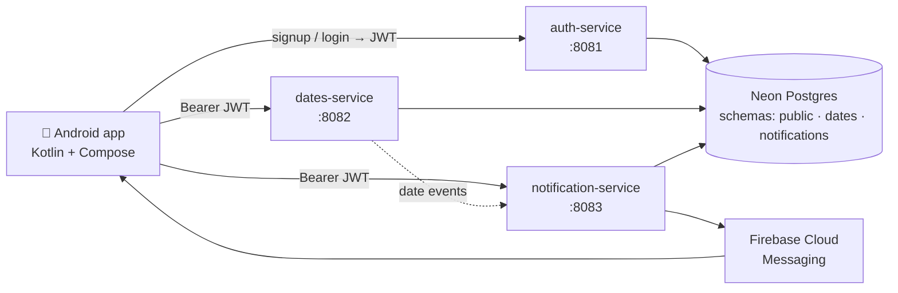

# Étoile ✨

A private date-planning app for two people. One person proposes a date, the other accepts, and the app helps settle the details (which movie, when, where) without endless back-and-forth.

Built as a hands-on learning project: **Kotlin + Jetpack Compose** on Android and **Java 21 + Spring Boot microservices** on the backend, all hosted for **$0**.

---

## Features

### Date types

| Type | Chosen at creation | Extra details |
|---|---|---|
| 🎬 **Movie date** (long-distance) | Date & time | Up to 2 movie suggestions per person at a time |
| ☕ **Meeting** | Date & time, place | Google Maps link, activity |
| 🧳 **Trip** | Date range, place | Itinerary |

### How a date works

- **Propose → accept / reject / cancel.** The receiver gets a notification and can accept or reject (rejecting is free). Cancelling costs saying *sorry* five times: the proposer can withdraw a pending invitation, and once a date is accepted either person can cancel it.
- **Movie suggestions.** Title and release year are required. Synopsis, YouTube trailer (shown as a thumbnail) and up to 5 genres (shown as coloured capsules) are optional.
- **Rescheduling.** A reschedule is a *request*, not a new time. The other person gets reminders (paused at night) until they open it and acknowledge with a cheeky button, which leads to a "We need to talk…" page. You agree on a time together, then either of you enters it (only after the acknowledgement). Only the requester can cancel a reschedule. Allowed any time before the date starts.

### Picking the movie 🍿

Every movie date has two lists:

- **🎯 Shortlist:** movies in the running. Each person can have at most **2 suggestions** on it at a time.
- **🗂️ Shelf:** every movie that came up but is out of the running. Reference only; any movie can be brought back.

| Situation | Result |
|---|---|
| 0 movies | Decided outside the app |
| 1 movie in the running | That's the movie |
| Both vote for the same movie | Decided |
| Votes differ | **Vote fails.** The shortlist narrows to the two voted movies, the rest go to the shelf |
| After talking it over: one of the two narrowed movies | Decided, *"We talked, we agreed 🤝"* |
| After talking it over: a shelf movie or a brand-new one | Decided, *"Okay fine, this one 😤"* (uses no suggestion slot) |
| Still stuck: **pick randomly** | Her voted movie 60%, his 40%. **Final**, nothing can change afterwards |

- **Votes are secret** until both have voted. You can change your vote until the other person votes.
- **Changing your mind is allowed** (*"Indecisive much… 👀"*): adding a movie or bringing one back from the shelf reopens voting at any stage before the random pick. Removing a movie moves it to the shelf, and only resets the votes if someone had voted for it.
- **Timing:** the first round of suggestions closes 5 hours before the date. After the first vote, movies can be added until the date starts.

### Notifications 🔔

- **Date events go to the other person:** new invitation, accepted, rejected, cancelled, reschedule requested / acknowledged / new time / cancelled, new movie suggested, "has voted" (not *which* movie), votes split. The final movie decision goes to both.
- **Merged, not stacked.** Pushes about the same date replace each other on the phone, and new movies are counted ("2 new movies for your movie date on 28 Nov, 7:30 PM").
- **Send love 💗.** The first love buzzes. More love before it is seen quietly updates the same notification, with texts that escalate by count (×2 … *"Incoming love overload"* … *"Love levels critical!"* … *"System overloaded with love"*).
- **Need love 🥺.** Asks the other person for love. Pressing it again sends a fresh, cheekier push and restarts the reminders.
- **Reminders** (Need love and reschedule requests only): every 5 minutes for up to 30 minutes, until the other person responds. They pause during quiet hours (00:30–07:30 India time) and resume afterwards. One-off pushes are still delivered at night.

### Genres

General: `ACTION` `ADVENTURE` `ANIMATION` `COMEDY` `CRIME` `DOCUMENTARY` `DRAMA` `FAMILY` `FANTASY` `HORROR` `MUSICAL` `MYSTERY` `ROMANCE` `SCI_FI` `THRILLER` `OTHER`

Anime: `ANIME` `SHONEN` `SHOJO` `SEINEN` `JOSEI` `ISEKAI` `MECHA` `SLICE_OF_LIFE` `MAGICAL_GIRL`

---

## Architecture



- **No API gateway (v1).** The app calls each service directly.
- **One database, separate schemas.** Each service owns its own tables.
- **Stateless JWT auth.** auth-service signs tokens (HS256). The other services only verify them, reading the user's id and role straight from the token.
- **Date events.** After a change is saved, dates-service tells notification-service in the background, forwarding the acting user's own JWT. If notification-service is down, the date action still succeeds.
- **Exactly two accounts.** Each user has a role, `HIM` or `HER`, and the database allows only one of each. The role drives small per-person differences in the app and the 60/40 tie-break weighting.

---

## Tech stack

| Layer | Tech |
|---|---|
| Backend | Java 21, Spring Boot 4.1, Spring Security (OAuth2 Resource Server / Nimbus JWT), Spring Data JPA, Bean Validation |
| Database | PostgreSQL on [Neon](https://neon.tech) (free tier) |
| Android | Kotlin, Jetpack Compose *(planned)* |
| Push | Firebase Cloud Messaging (Firebase Admin SDK) |
| Hosting | [Render](https://render.com) free tier *(planned)* |
| Build | Maven |

---

## Repository layout

```
etoile/
├── auth-service/          # signup, login, JWT issuing
├── dates-service/         # dates, suggestions, voting, rescheduling
├── notification-service/  # push notifications, love, reminders
└── android-app/           # Kotlin + Compose client (planned)
```

---

## Status

| Part | Status |
|---|---|
| auth-service | ✅ Done: signup, login, change password, BCrypt, JWT, HIM/HER roles |
| dates-service | ✅ Done: dates, accept/reject/cancel, rescheduling, movie shortlist/shelf, secret voting, random pick, listing, date events for notifications |
| notification-service | ✅ Done: device registration, FCM push with merging, date notifications, send/need love, reminders with quiet hours |
| android-app | ⏳ Not started |
| Deployment (Render) | ⏳ Not started |

---

## Running locally

### Prerequisites

- JDK 21
- Maven (IntelliJ's bundled Maven works)
- A PostgreSQL database (a free [Neon](https://neon.tech) project works)

### Environment variables

Secrets are **never** stored in this repo. Each service reads them from environment variables. In IntelliJ, set them in the service's Run Configuration and keep *Store as project file* unticked.

| Variable | Used by | Description |
|---|---|---|
| `DB_URL` | all services | JDBC URL, e.g. `jdbc:postgresql://<host>/<db>?sslmode=require` |
| `DB_USER` | all services | Database user |
| `DB_PASSWORD` | all services | Database password |
| `JWT_SECRET` | all services | Base64-encoded key of at least 32 random bytes. **Must be identical in every service.** |
| `FIREBASE_CREDENTIALS` | notification-service | Base64 of the Firebase service-account JSON. Empty = log-only mode (pushes are only logged) |
| `NOTIFICATIONS_URL` | dates-service | Optional. Where notification-service runs. Default `http://localhost:8083` |

Optional, for notification-service testing: `REMINDER_EVERY_SECONDS` (default 300), `REMINDER_WINDOW_SECONDS` (1800), `REMINDER_TICK_MS` (30000), `QUIET_START` (00:30), `QUIET_END` (07:30).

Generate a `JWT_SECRET` in PowerShell (it goes straight to the clipboard, never on screen):

```powershell
$b = New-Object byte[] 48; [System.Security.Cryptography.RandomNumberGenerator]::Create().GetBytes($b); [Convert]::ToBase64String($b) | Set-Clipboard
```

Copy the Firebase key as Base64 for `FIREBASE_CREDENTIALS` (keep the key file **outside** this repo; use your own path):

```powershell
[Convert]::ToBase64String([IO.File]::ReadAllBytes("C:\path\outside\repo\firebase-key.json")) | Set-Clipboard
```

### Start the services

Run each service's main class from IntelliJ:

| Service | Main class | Port |
|---|---|---|
| auth-service | `com.etoile.authservice.AuthServiceApplication` | 8081 |
| dates-service | `com.etoile.datesservice.DatesServiceApplication` | 8082 |
| notification-service | `com.etoile.notificationservice.NotificationServiceApplication` | 8083 |

Tables are created automatically on startup (`ddl-auto=update`).

---

## API

Every endpoint except signup and login needs the header `Authorization: Bearer <token>`. Errors come back as [RFC 9457 Problem Details](https://www.rfc-editor.org/rfc/rfc9457) JSON.

### auth-service (`:8081`)

| Method | Path | Body | Success |
|---|---|---|---|
| `POST` | `/api/auth/signup` | `email`, `password` (8–72), `displayName`, `role` (`HIM`/`HER`) | `201` → `token`, `userId`, `displayName`, `role` |
| `POST` | `/api/auth/login` | `email`, `password` | `200` → `token`, `userId`, `displayName`, `role` |
| `POST` | `/api/auth/change-password` | `currentPassword`, `newPassword` (8–72) | Login required. `200` → fresh `token` and user info |

### dates-service (`:8082`)

Every endpoint below returns the full **date**, built for the caller (so the other person's vote stays hidden until both have voted). A date includes `shortlist`, `shelf`, `decision`, `voting` and `reschedule`.

**General**

| Method | Path | Body | Notes |
|---|---|---|---|
| `GET` | `/api/me` | — | Caller's `id`, `role`, `name` |
| `GET` | `/api/dates` | — | Upcoming dates, soonest first. `?scope=past` for past ones |
| `GET` | `/api/dates/{id}` | — | One date |

**Create and respond**

| Method | Path | Body | Notes |
|---|---|---|---|
| `POST` | `/api/dates/movie` | `startsAt`, `suggestions[]` (0–2) | `201` |
| `POST` | `/api/dates/meeting` | `startsAt`, `place`, `mapsLink`, `activity` | `201` |
| `POST` | `/api/dates/trip` | `startsAt`, `endsAt`, `place`, `itinerary` | `201` |
| `POST` | `/api/dates/{id}/accept` | — | Receiver, while proposed |
| `POST` | `/api/dates/{id}/reject` | — | Receiver, while proposed |
| `POST` | `/api/dates/{id}/cancel` | `sorryCount` (must be 5) | Proposer while proposed; either person once accepted |

**Reschedule**

| Method | Path | Body | Notes |
|---|---|---|---|
| `POST` | `/api/dates/{id}/reschedule` | — | Either person, accepted dates |
| `POST` | `/api/dates/{id}/reschedule/acknowledge` | — | The other person |
| `POST` | `/api/dates/{id}/reschedule/new-time` | `startsAt`, `endsAt` (trips) | Either person, after the acknowledgement |
| `POST` | `/api/dates/{id}/reschedule/cancel` | — | The requester |

**Movie decision**

| Method | Path | Body | Notes |
|---|---|---|---|
| `POST` | `/api/dates/{id}/suggestions` | one suggestion | `201`. Needs a free slot; reopens voting |
| `POST` | `/api/dates/{id}/suggestions/{sid}/shelve` | — | Your own suggestion, or the agreed movie |
| `POST` | `/api/dates/{id}/suggestions/{sid}/bring-back` | — | Uses your slot; reopens voting |
| `POST` | `/api/dates/{id}/vote` | `suggestionId` | Secret until both have voted |
| `POST` | `/api/dates/{id}/agree` | `suggestionId` **or** `newMovie` | After a failed vote |
| `POST` | `/api/dates/{id}/random-pick` | — | After a failed vote. 60/40, final |

<details>
<summary>Example: propose a movie date</summary>

```http
POST /api/dates/movie
Authorization: Bearer <token>
Content-Type: application/json

{
  "startsAt": "2026-11-25T20:00:00+05:30",
  "suggestions": [
    {
      "title": "Your Name",
      "releaseYear": 2016,
      "youtubeUrl": "https://youtu.be/...",
      "genres": ["ANIME", "ROMANCE", "FANTASY"]
    }
  ]
}
```

Response `201 Created`:

```json
{
  "id": "4888d0b7-...",
  "type": "MOVIE",
  "status": "PROPOSED",
  "proposedBy": "HIM",
  "startsAt": "2026-11-25T14:30:00Z",
  "shortlist": [
    {
      "suggestedBy": "HIM",
      "title": "Your Name",
      "releaseYear": 2016,
      "genres": ["FANTASY", "ROMANCE", "ANIME"],
      "shortlisted": true
    }
  ],
  "shelf": [],
  "decision": { "movieId": "…", "title": "Your Name", "method": "ONLY_ONE", "isFinal": false },
  "voting": { "himVoted": false, "herVoted": false },
  "reschedule": null
}
```

Times are stored and returned in UTC (`Z`). The app converts them to local time.
</details>

### notification-service (`:8083`)

| Method | Path | Body | Notes |
|---|---|---|---|
| `POST` | `/api/devices` | `token` | Register this phone's FCM token for the caller |
| `POST` | `/api/devices/unregister` | `token` | On logout |
| `POST` | `/api/notifications/seen` | `groupKey` (e.g. `date-<id>`) | `204`. Resets that group's merged count |
| `POST` | `/api/notifications/test` | — | Sends yourself a test push |
| `GET` | `/api/love` | — | `loveReceived`, `theyNeedYou`, `youAreWaiting` |
| `POST` | `/api/love/send` | `taps` (1–100) | One burst of hearts |
| `POST` | `/api/love/need` | — | Ask for love; starts reminders |
| `POST` | `/api/love/seen` | — | Love icon opened: clears count, highlight and reminders |
| `POST` | `/api/events/date` | `type`, `dateId`, `dateType`, `startsAt`, … | `204`. Called by dates-service, not the app |

---

## Roadmap

- [x] auth-service: signup, login, JWT, roles
- [x] dates-service: create movie, meeting and trip dates
- [x] dates-service: accept, reject, cancel
- [x] dates-service: movie shortlist and shelf
- [x] dates-service: secret voting, call decision, weighted random pick
- [x] dates-service: reschedule requests
- [x] dates-service: list upcoming / past dates, date details
- [x] auth-service: change password
- [x] notification-service: FCM push with merging, date notifications
- [x] notification-service: send love / need love, reminders with quiet hours
- [ ] deployment (Render or Oracle Cloud)
- [ ] android-app
- [ ] Deploy to Render (free tier)
